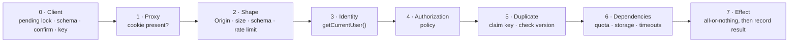
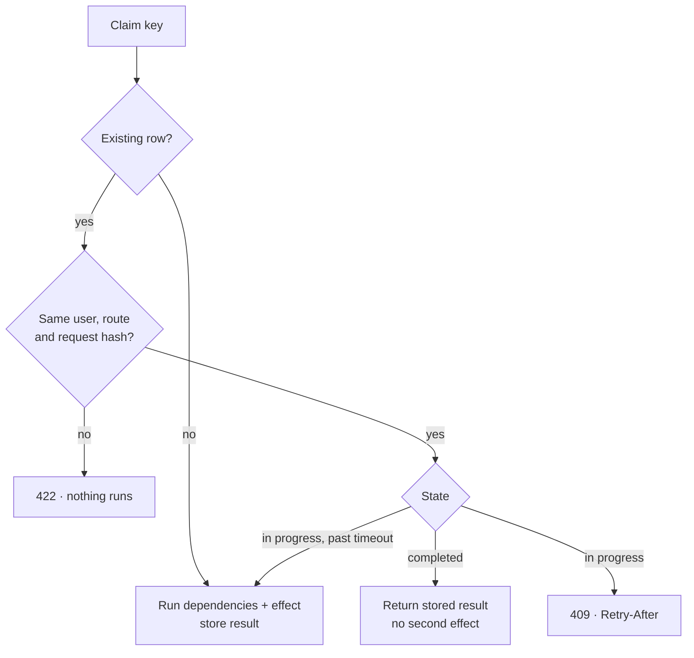

# Secure File Vault

A secure file upload module in a full-stack Next.js (TypeScript) and PostgreSQL app:
registration, login with database sessions, file uploads, and owner-or-admin access to every file.

The repository holds the specification and the application built from it, one module at a time.
Every request the application serves passes the same ordered set of guardrails.

## What is in the repository

```
src/
  app/                     pages, Server Actions and route handlers (thin)
  server/                  services, policy, sessions, storage, database (server-only)
  lib/                     helpers and schemas shared by the browser and the server
  env.ts                   the only reader of the environment
  proxy.ts                 optimistic redirects; not a security boundary
scripts/                   migrate, seed the first admin, sweep abandoned uploads
docker-compose.yml         PostgreSQL 17
.github/                   CI workflow, pull request template, code owners
AGENTS.md                  rules for every contributor and coding agent (start here)
CLAUDE.md                  agent entry point; imports AGENTS.md
docs/
  brief.md                 requirements and how they are interpreted
  architecture/            folder layout, layering, data model
  modules/                 one file per module, in build order (setup → collaboration)
  security/rules.md        binding security rules
  security/request-flow.md request guardrails: gate order, duplicates, confirmation, dependencies
  decisions/               each technical choice with two options and the trade-offs
  scenarios/               happy path (H), failures (F), edge cases (E), bottlenecks (B)
  workflow/                how a change moves from plan to merge
  references.md            official documentation the docs rely on
```

## The application it describes

| Area | Design |
|---|---|
| Accounts | Name, username, password and role (`admin` or `staff`). Self-registration always creates `staff`; only the seed script or an admin creates an admin |
| Passwords | argon2id at the OWASP minimum parameters, length checked before hashing |
| Sessions | 32 random bytes in an `HttpOnly`, `SameSite=Lax` cookie; the database stores only the SHA-256 hash, so a database leak does not hand out live sessions. Rotated on login, deleted on logout, revoked when a user is disabled |
| Authorization | Checked in the service layer on every request with `getCurrentUser()` plus a policy function. The proxy and hidden UI are convenience only |
| File access | One rule, `canAccessFile(user, file)`: the uploader or any admin. Staff list queries are scoped in SQL, never filtered afterwards |
| Refusal | A file the user may not see, a missing file and a malformed id all return the same 404, so a response never confirms that a file exists |
| Uploads | Raw-body `PUT` with an `Origin` check, a size limit enforced before and during streaming, type detected from the file's first bytes against an allow-list, a server-generated storage key, and a `pending → ready` lifecycle so a failed upload leaves nothing behind |
| Downloads | Streamed through an authorized route with `attachment` disposition, `nosniff` and `no-store`; a missing blob is a 404, never a truncated response |
| Configuration and logs | One Zod-validated reader of the environment; structured logs that redact passwords, cookies, authorization headers and bodies |

Layering keeps these rules in one place: thin routes in `src/app/` call `src/server/<module>/service.ts`,
which alone talks to the database and storage.

## Request guardrails

Every request passes the same gates in the same order, and each gate lives in one layer. A gate runs only after
the previous one passed, so a request is rejected at the cheapest point that can reject it.



| Gate | What it guarantees | When it fails |
|---|---|---|
| Client | The submit button is locked while a request is pending; input is checked against the same schema the server uses; irreversible actions ask for confirmation; each user intent gets one idempotency key | Nothing is sent. These checks are convenience only, and the server repeats every one |
| Proxy | Pages without a session cookie redirect to login | Redirect. Not a security boundary; uploads bypass it entirely |
| Shape | The method, `Origin`, size, headers and body match an explicit schema; only named fields are written; rate limits apply before any expensive work | 400, 403, 413, 415 or 429; a bad file id is the standard 404 |
| Identity | The session is valid and the user is active | Not logged in → 401 or redirect; a failed lookup → 503, never anonymous |
| Authorization | The policy function allows this user this action | 404 for files, 403 elsewhere |
| Duplicate | The idempotency key is claimed before any effect; irreversible changes still match the version the user saw | A repeat returns the first result with no second effect; in progress or stale → 409; a key reused for a different request → 422 |
| Dependencies | Quota, storage and the database are available, and every call is bounded by a timeout | 503 with `Retry-After`, or 507 when storage is full |
| Effect | The change happens completely or not at all, then its result is stored under the key | Rolled back, and the key is released so a retry can run |

### Duplicate requests
Double clicks, browser retries after a network error and resubmitted forms all reach the server as repeats.
Anything that creates something or cannot be undone (registration, uploads, admin actions) carries an
`Idempotency-Key` that the client generates once per intent and reuses on every retry. The server claims the key in
the `idempotency_keys` table before acting:



Stored results are small (an id or a redirect target) and never contain file contents, tokens or request bodies.
Keys expire after 24 hours.

### Confirmation
Deleting a file, disabling a user or changing a role asks the user to confirm, but the server does not rely on the
dialog. The request carries the `updated_at` of the record as the user saw it; if the record changed in the meantime,
nothing happens and the response is 409, so nobody acts on a stale view.

### Dependencies
The app reports ready on `GET /api/health` only when PostgreSQL answers, migrations are current and storage is
writable; the response carries no detail. Every database and storage call has a timeout, a slow dependency fails
with 503 instead of holding connections, and the server never retries a write on its own.

The full rules are 24–29 in [docs/security/rules.md](docs/security/rules.md); the reasoning behind the order is in
[docs/security/request-flow.md](docs/security/request-flow.md).

## Getting started
Requires Node.js 24, Docker and git.

```
cp .env.example .env.local          # then set SEED_ADMIN_PASSWORD to a long passphrase
docker compose up -d --wait         # PostgreSQL on 127.0.0.1:5433
npm ci && mkdir -p storage
npm run db:migrate && npm run db:seed
npm run dev                         # http://localhost:3000
```

`GET /api/health` returns 200 once the database is migrated and `storage/` is writable.
Before changing anything, read [AGENTS.md](AGENTS.md) and [docs/modules/README.md](docs/modules/README.md).
