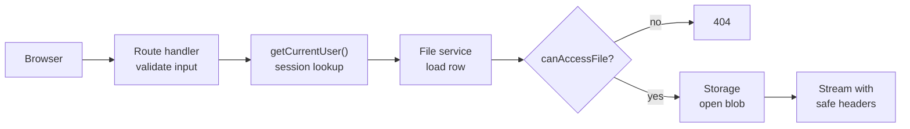
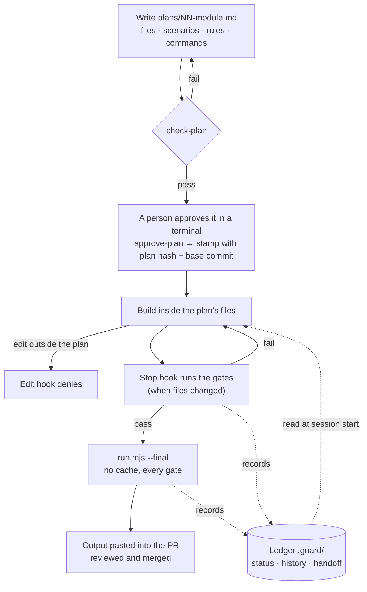

# Secure File Vault

A blueprint for a secure file upload module in a full-stack Next.js (TypeScript) and PostgreSQL app:
registration, login with database sessions, file uploads, and owner-or-admin access to every file.

The repository holds the specification and the controls around building it. The application is built from
these documents one module at a time, and every change passes through a plan that a person approves and
a set of pass/fail gates that decide when the work is done.

## What is in the repository

```
AGENTS.md                  rules for every contributor and coding agent (start here)
CLAUDE.md                  agent entry point; imports AGENTS.md
docs/
  brief.md                 requirements and how they are interpreted
  architecture/            folder layout, layering, data model
  modules/                 one file per module, in build order (setup → collaboration)
  security/rules.md        binding security rules
  decisions/               each technical choice with two options and the trade-offs
  scenarios/               happy path (H), failures (F), edge cases (E), bottlenecks (B)
  workflow/                how a change moves from plan to merge
  references.md            official documentation the docs rely on
plans/                     one approved plan per change, plus its approval stamp
scripts/guard/             the gate scripts, the run ledger and the agent hooks
.claude/settings.json      hook wiring for the agent
```

## The application it describes

| Area | Design |
|---|---|
| Accounts | Name, username, password and role (`admin` or `staff`). Self-registration always creates `staff`; only the seed script or an admin creates an admin |
| Passwords | argon2id at the OWASP minimum parameters, length checked before hashing |
| Sessions | 32 random bytes in an `HttpOnly`, `SameSite=Lax` cookie; the database stores only the SHA-256 hash, so a database leak does not hand out live sessions. Rotated on login, deleted on logout, revoked when a user is disabled |
| Authorization | Checked in the service layer on every request with `getCurrentUser()` plus a policy function. The proxy and hidden UI are convenience only |
| File access | One rule, `canAccessFile(user, file)`: the uploader or any admin. Staff list queries are scoped in SQL, never filtered afterwards |
| Refusal | A file the user may not see, a missing file and a malformed id all return the same 404, so a response never confirms that a file exists |
| Uploads | Raw-body `PUT` with an `Origin` check, a size limit enforced before and during streaming, type detected from the file's first bytes against an allow-list, a server-generated storage key, and a `pending → ready` lifecycle so a failed upload leaves nothing behind |
| Downloads | Streamed through an authorized route with `attachment` disposition, `nosniff` and `no-store`; a missing blob is a 404, never a truncated response |
| Configuration and logs | One Zod-validated reader of the environment; structured logs that redact passwords, cookies, authorization headers and bodies |

Layering keeps these rules in one place: thin routes in `src/app/` call `src/server/<module>/service.ts`,
which alone talks to the database and storage.



## How a change is made

Every change follows the same loop, and each step is enforced by a script rather than by instruction.



### Plans and approval
- A plan is `plans/<module>.md`: prose plus one `json plan` block listing the files it may change, the scenario
  IDs it covers, the security rules that apply and the commands that verify it. The format is in
  [plans/README.md](plans/README.md).
- `check-plan` rejects a plan whose files fall outside the allowed folders, whose scenario IDs or rule numbers do
  not exist, or that leaves out a scenario its module file lists.
- Approval is a person running `approve-plan` in an interactive terminal and typing the module name. It writes
  `plans/<module>.approved.json` with the plan file's SHA-256 and the base commit. Any later edit to the plan
  voids the approval until it is approved again.

### Gates
`node scripts/guard/run.mjs [--final]` is the single entry point. Each gate exits pass or fail:

| Gate | Fails when |
|---|---|
| `plan` | The plan does not pass `check-plan` |
| `approval` | The stamp is missing or the plan changed after approval |
| `scope` | Any file changed since the base commit, by any tool, is not listed in the plan (read from git) |
| `scenarios` | A scenario ID the module lists has no named check in the repository |
| plan commands | Any command in the plan (lint, type checks and the rest) exits non-zero; they run only from an approved plan |

### Run ledger and handoff
Results are recorded in `.guard/` (git-ignored), so repeated runs are cheap and a new session starts with the
current state instead of rediscovering it.

- `status/<module>.json`: the latest result of each gate, with the hash of the files it ran against.
- `runs/<module>.jsonl`: the last 200 gate runs.
- `handoff/<module>.md`: generated from git and the ledger only. It covers plan and approval state, files in and
  out of scope, gate results, scenario coverage, the last failure and the next step. Notes from an agent appear
  in a separate section marked "claims, not verified".

A passing command is skipped while the files it ran against are unchanged. A failing command always reruns.
`--final` ignores the cache and is the only result that counts as done. Stored output is limited to the last
20 lines, with tokens, cookies, passwords and authorization values redacted.

### Agent hooks
The hooks in `.claude/settings.json` are thin wrappers around the same scripts:

| Hook | Behaviour |
|---|---|
| Session start | Prints the active module's handoff into the new session |
| Before an edit | Denies edits to files outside the approved plan, to approval stamps and the ledger, and to guard files unless a workflow plan lists them; denies on any internal error |
| Before a shell command | Denies running `approve-plan` or writing approval stamps |
| Stop | When files changed, runs the gates and blocks the stop with the failing gate's summary |

Agents that do not load these hooks follow the same loop by running the scripts directly, starting from
`.guard/handoff/<module>.md`.

## Limits of the controls
The gates catch drift and mistakes: scope creep, unverified claims of completion, missing scenario coverage and
lost state between sessions. They are not tamper-proof. A shell can imitate a terminal and an approval stamp is a
file, so the final authority is human review of every pull request, including `plans/*.approved.json`,
`scripts/guard/` and `.claude/`.

## Getting started
1. Read [AGENTS.md](AGENTS.md), then [docs/modules/01-setup.md](docs/modules/01-setup.md).
2. Write `plans/01-setup.md` and check it: `node scripts/guard/check-plan.mjs plans/01-setup.md`
3. Approve it in a terminal: `node scripts/guard/approve-plan.mjs plans/01-setup.md`
4. Build, then finish with `node scripts/guard/run.mjs --final`.

Requires Node.js 24 and git. The guard scripts have no dependencies.
