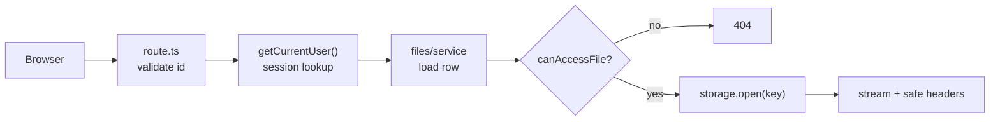

# Architecture overview

## Stack (defaults; each has a decision file with the alternative)
Node.js 24 · Next.js 16 App Router, TS `strict` · PostgreSQL 17 in Docker Compose · Drizzle ORM ·
Zod · argon2id (`@node-rs/argon2`) · opaque DB sessions · `StorageProvider` (local disk, S3 later) ·
`file-type` for byte sniffing · Vitest + Playwright · npm with a committed lockfile.

Versions checked on npm on 2026-10-14: `next` 16.4.0, `drizzle-orm` 0.45.4, `zod` 4.6.7,
`@node-rs/argon2` 2.2.2, `vitest` 5.0.4, `@playwright/test` 1.64.1. Re-check before installing.

## Folder layout
```
src/
  app/                          routing only: pages, layouts, route handlers (thin)
    (auth)/login/  (auth)/register/
    (app)/files/   (app)/admin/
    api/files/route.ts                 PUT upload (raw body)
    api/files/[id]/download/route.ts   GET download
    api/health/route.ts                readiness: 200 or 503, no detail
  server/                       server-only; every file imports "server-only" (except db/schema.ts, which drizzle-kit loads)
    db/        client.ts  schema.ts  migrations/
    auth/      password.ts  session.ts  current-user.ts  service.ts
    files/     policy.ts  service.ts  upload.ts
    storage/   types.ts  local-disk.ts
    errors.ts  http.ts  log.ts  health.ts  idempotency.ts
  lib/                          isomorphic helpers (username.ts, content-disposition.ts),
                                schemas/ shared by forms and server
  env.ts                        Zod-validated env; the ONLY reader of process.env
  proxy.ts                      optimistic redirects only; NOT an auth boundary
scripts/                        migrate.ts  seed.ts
tests/                          unit + integration; e2e/ for Playwright
```

## Layering
`app/` → `server/<module>/service.ts` → `server/db`, `server/storage`
- Routes and Server Actions: validate input with Zod, call one service, map the result to a response
- Services: own the business rules, call the policy, talk to db and storage
- Services throw typed errors (`NotFoundError`, `UnauthorizedError`, `ValidationError`); one helper in `http.ts` maps them to status codes

## Request flow: download


## Why this shape
- `server/` can move to a separate service later without rewriting routes
- `server-only` makes a build fail if a server module is imported into client code
- The Next.js docs recommend a Data Access Layer for auth checks and call Proxy checks "optimistic";
  see [references.md](../references.md)
