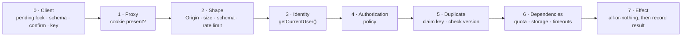

# Request flow guardrails

Every request passes the same gates in the same order. A gate runs only after the one before it passed,
and each gate lives in exactly one layer. The binding rules are 24–29 in [rules.md](rules.md).

| # | Gate | Where | Checks | On failure |
|---|---|---|---|---|
| 0 | Client | browser | Submit disabled while pending; the shared Zod schema from `src/lib/schemas/`; size and type pre-check before sending bytes; a confirm step for irreversible actions; one `Idempotency-Key` per user intent, reused on retry | Nothing is sent. **UX only: every check is repeated on the server (rule 29)** |
| 1 | Proxy | `src/proxy.ts` | A session cookie exists (pages only, never `/api/files`) | Redirect to `/login`. Not a security boundary |
| 2 | Shape | route handler / Server Action | Method; `Origin` (route handlers, rule 13); `Content-Length` (rule 14); Zod parse of params, headers and body; `Idempotency-Key` is a UUID where required; rate limit ([decisions/09](../decisions/09-rate-limiting.md)) | 400 · 403 · 413 · 415 · 429. A bad file id is the standard 404 (rule 4) |
| 3 | Identity | service | `getCurrentUser()`: session valid, user not disabled | Not logged in → 401 or redirect. Lookup failed → 503, never anonymous (F3) |
| 4 | Authorization | service | The policy function (`canAccessFile`, role checks) | 404 for files (rule 4), 403 elsewhere |
| 5 | Duplicate | service | Claim the idempotency key (rule 26); for irreversible changes, the version the user saw still matches (rule 27) | Replay of the stored result · 409 in progress or stale · 422 key reused for a different request |
| 6 | Dependencies | service | Quota (E13), storage reachable, every call bounded by a timeout (rule 28) | 503 with `Retry-After`; 507 when storage is full (F9) |
| 7 | Effect | service | Transaction or `pending → ready` (rule 17); then store the result under the key | Roll back; release the key so a retry can run |

## Why this order
- **Shape before identity:** garbage is rejected without a database call, and the rate limit runs before argon2 or storage work.
- **Identity and authorization before the duplicate check:** a key can be replayed only by the user who created it,
  so keys cannot be used to probe other users' requests.
- **Duplicate check before dependencies and effects:** a retried upload must not reserve quota or open a second write.
- **Dependencies right before the effect:** checking storage at the start of a request that may still be refused wastes the check
  and tells an attacker which dependency is down.

## Duplicate requests
- **Where they come from:** double clicks, a browser retry after a network error, the back button resubmitting a form,
  a client that times out while the server is still working.
- **Natural idempotency first:** logout deletes a row that may already be gone; a second login only rotates the session.
  These need no key.
- **Keyed actions:** anything that creates something or cannot be undone: register, upload, and admin actions when they are built.
  The client generates the key with `crypto.randomUUID()` when the user starts the action and sends the same key on every retry.
- **Claim:** `INSERT INTO idempotency_keys … ON CONFLICT DO NOTHING`, then read the row ([data-model.md](../architecture/data-model.md)):

  | Stored row | Same request? | Response |
  |---|---|---|
  | none (claim succeeded) | — | Run gates 6–7, store status and result |
  | `completed` | yes | The stored result; no second effect (E20) |
  | `in_progress`, younger than the request timeout | yes | 409 with `Retry-After` (E20) |
  | `in_progress`, older than the request timeout | yes | Treated as abandoned; reclaimed |
  | any | no (other user, other route, other request hash) | 422; nothing runs (E21) |

- **Request hash:** SHA-256 of the route plus the validated input. For uploads, the input is `X-File-Name` and the declared length,
  because the body is not known until it is streamed.
- **Stored result:** status and a small JSON result (an id, a redirect target). Never file contents, tokens or the request body (rule 5).
- **Failure releases the key:** if gate 6 or 7 fails, the claim is deleted so the same key can retry.

## Confirmation
- The client asks before an irreversible action: delete a file, disable a user, change a role.
- The server does not trust the dialog. The request carries the target's `updated_at` as the user saw it; if the row changed
  since, nothing happens and the response is 409 (E22). The user sees the current state and decides again.
- No module builds these actions yet; the rule binds when one does.

## Dependencies
- **At startup and deploy:** the app is ready only when PostgreSQL answers, the migrations are current, and `STORAGE_DIR`
  is writable. `GET /api/health` returns 200 or 503 with no detail in the body; detail goes to the log (F11).
- **Per request:** no health ping on every request. Every database and storage call has a timeout
  (PostgreSQL `statement_timeout`, pool connection timeout, storage operation timeout), so a slow dependency
  fails fast with 503 instead of holding connections (F12).
- **No silent retries of effects:** the server never retries a non-idempotent write. The client may retry, with the same key.
- **Build dependencies:** packages are checked separately (F10).
